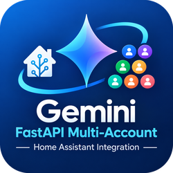

# Gemini FastAPI Multi-Account HACS

<p align="center">
  
</p>

Tích hợp HACS cho Home Assistant, tối ưu riêng để kết nối với container **gemini-fastapi-multi-account** qua API OpenAI-compatible (`/v1`).

Repo HACS: `gemini-fastapi-multi-account-hacs`  
Home Assistant domain: `gemini_fastapi_multi_account`

Icon tích hợp được đóng gói tại `custom_components/gemini_fastapi_multi_account/brand/icon.png` (250×250 PNG). Home Assistant 2026.3+ sẽ tự dùng brand image cục bộ này; bản HA cũ hơn vẫn chạy integration nhưng có thể không hiển thị icon cục bộ.

## Yêu cầu

- Home Assistant 2025.7.0 trở lên; khuyến nghị Home Assistant bản ổn định mới nhất.
- HACS 2.0.5 trở lên.
- Container `gemini-fastapi-multi-account` đang hoạt động và truy cập được từ Home Assistant.

> Nếu bạn đang cài `Local OpenAI LLM` cũ, nên gỡ/disable bản cũ trước khi cài bản này để tránh hai integration cùng tải các phiên bản dependency OpenAI khác nhau.

## URL nên dùng

Nếu Home Assistant OS/Supervised chạy ở máy khác hoặc không cùng Docker network:

```text
http://192.168.1.50:8000
```

Nếu Home Assistant Container và Gemini FastAPI ở **cùng một Docker network**:

```text
http://gemini-fastapi-multi-account:8000
```

Không dùng `127.0.0.1:8000` từ Home Assistant Container trừ khi API thực sự chạy trong chính container Home Assistant.

API key trong integration phải khớp với `CONFIG_SERVER__API_KEY` của container. Nếu server để `api_key: null`/không bật xác thực, có thể để trống ô API key.

## Cài bằng HACS Custom Repository

1. Push repo này lên GitHub.
2. Vào **HACS → Integrations → dấu ba chấm → Custom repositories**.
3. Thêm:

```text
https://github.com/khaisilk1910/gemini-fastapi-multi-account-hacs
```

4. Category: **Integration**.
5. Tìm **Gemini FastAPI Multi-Account** → Download.
6. Restart Home Assistant.
7. Vào **Settings → Devices & services → Add integration**.
8. Tìm **Gemini FastAPI Multi-Account**.
9. Nhập Server URL và API key.
10. Thêm Conversation Agent và/hoặc AI Task subentry, chọn model từ `/v1/models`.

Việc kiểm tra `/v1/models` chỉ diễn ra khi cấu hình/mở form chọn model, không chạy trong quá trình boot Home Assistant.


## Kiểm tra nhanh API trước khi thêm integration

Từ một máy có thể truy cập container:

```bash
curl http://HOST:8000/health
curl -H "Authorization: Bearer YOUR_API_KEY" http://HOST:8000/v1/models
```

Nếu container không bật API key thì bỏ header `Authorization`.


## Bản quyền

Integration này là bản sửa đổi/phái sinh của `hass_local_openai_llm` và giữ giấy phép **Apache License 2.0**. Xem `LICENSE` và `NOTICE`.

Container `gemini-fastapi-multi-account` là dự án riêng và giữ giấy phép riêng của container; mã server không được nhúng vào repo HACS này.
